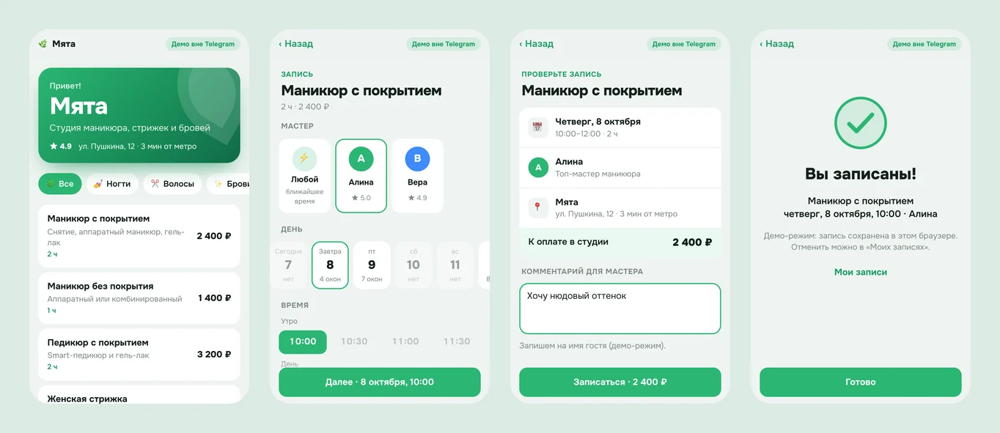
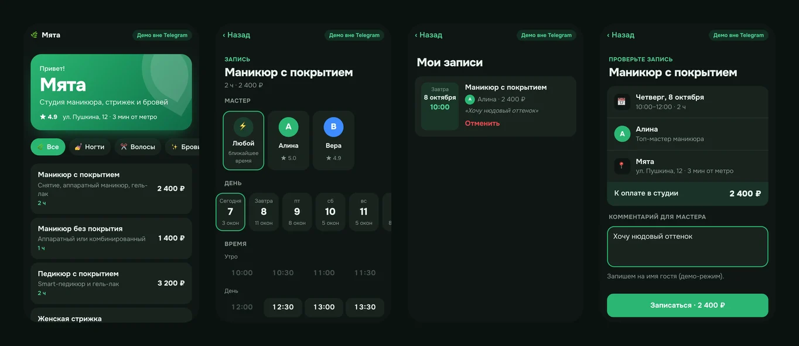

# 🌿 Мята — Telegram Mini App для записи в студию

Онлайн-запись в студию маникюра, стрижек и бровей прямо в Telegram: услуга →
мастер → день → время → подтверждение. Приложение берёт цвета темы
пользователя, пользуется родными кнопками Telegram, вибрацией и облачным
хранилищем. Вне Telegram работает в демо-режиме.

**Демо в браузере:** https://dmitriy9427.github.io/myata/




## Что внутри

- **Telegram WebApp API**: `MainButton` и `BackButton` через React-хуки,
  `HapticFeedback`, `CloudStorage` (записи видны на всех устройствах),
  `showConfirm`, защита от случайного закрытия, проверка версии клиента.
- **Тема Telegram** через CSS-переменные `--tg-theme-*` и запасная мятная
  палитра (светлая и тёмная) для браузера.
- **Демо-режим**: та же логика, кнопки Telegram заменены своими, хранилище —
  `localStorage`. Экраны не знают, в каком они режиме.
- **Расписание**: свободные окна с учётом длительности услуги, рабочих дней
  мастера, «не раньше чем за час» и своих записей; режим «любой мастер».
- **MemoryRouter** (hash занят параметрами Telegram) и сброс истории после
  записи, чтобы «назад» не возвращал в форму.
- Тесты логики на Vitest, проверка в CI перед деплоем.

## Стек

React 19 · TypeScript · Vite · React Router · Zustand · SCSS · Vitest ·
GitHub Actions + Pages

## Как устроено — учебник

Начать — с [вводной главы](docs/00-start.md) и [разбора кода](docs/code/README.md). В папке [`docs/`](docs/README.md) — разбор проекта по главам: что такое Mini
Apps, обёртка над API, нативный интерфейс, расписание, **безопасность
`initData` и проверка подписи на сервере**, подключение к боту в @BotFather,
деплой и отладка. Плюс [уроки по найденным багам](docs/lessons.md) и
[шпаргалка к собеседованию](docs/interview.md).

## Запуск

```bash
npm install
npm run dev     # http://localhost:5193 — демо-режим
npm run check   # типы, линтер, тесты
npm run build
```

Чтобы открыть приложение внутри Telegram, создайте бота и укажите URL в кнопке
меню — пошагово в [главе 06](docs/06-botfather.md).

## Ограничения демо

Бэкенда нет: записи хранятся в CloudStorage самого пользователя, занятость
мастеров сгенерирована. Как сделать из этого продукт (сервер с проверкой
подписи, общая база, напоминания от бота) — в [главе 05](docs/05-security.md).
