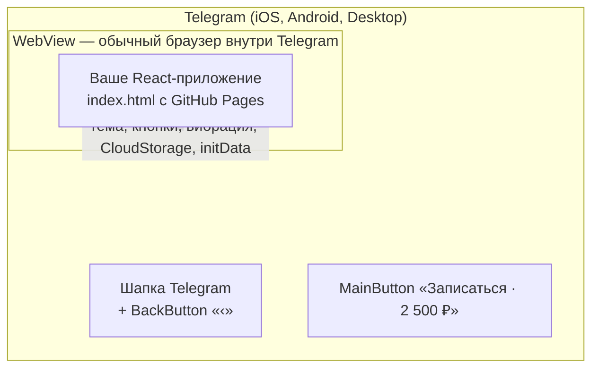

# 00. С чего начать

Этот учебник для человека, который знает React, но ещё не делал **Telegram Mini Apps** —
приложений, которые открываются прямо внутри Telegram. «Мята» — запись в салон: выбрать услугу,
мастера, день и время, подтвердить.

## Как устроена каждая глава

1. **Зачем** — что видит человек и какую задачу решаем.
2. **Как это выглядит** — маленький пример.
3. **Как это сделано в «Мяте»** — настоящий код с разбором.
4. **Ошибки** — что ломается у всех в первый раз.
5. **Попробуйте сами** — задания с ответами под спойлером.

Вне Telegram приложение работает в **демо-режиме**: кнопки Telegram заменяются своими, хранилище —
`localStorage`. Можно учиться без бота и телефона.

## Картинка целиком: Mini App — это сайт в рамке Telegram

Главная мысль: **это обычный сайт**, открытый во встроенном браузере. Всё «телеграмное» — через
объект `window.Telegram.WebApp`: цвета темы пользователя, большая кнопка внизу, стрелка «назад» в
шапке, вибрация, облачное хранилище, данные о пользователе. «Мята» оборачивает его в один файл, и
экраны не знают, где они открыты.

## Словарь в одну строку

| Слово | Простыми словами | Пример в проекте |
| --- | --- | --- |
| **Mini App** | Веб-приложение, которое открывается внутри Telegram | вся «Мята» |
| **WebView** | Браузер, встроенный в другое приложение | Telegram на телефоне |
| **`Telegram.WebApp`** | Объект, через который сайт говорит с Telegram | `src/telegram/telegram.ts` |
| **`initData`** | Строка с данными о пользователе и подписью Telegram | проверка на сервере |
| **`initDataUnsafe`** | Те же данные, разобранные, **без проверки** | только для приветствия |
| **Версия Bot API** | Какие методы знает клиент Telegram пользователя | `supports('6.9')` |
| **MainButton** | Большая кнопка внизу экрана Telegram | «Записаться» |
| **BackButton** | Стрелка «назад» в шапке Telegram | на всех экранах, кроме главного |
| **`themeParams`** | Цвета темы пользователя → CSS-переменные | `--tg-theme-bg-color` |
| **Безопасная зона** | Место под вырезом и системными полосами | `--tg-safe-area-inset-*` |
| **CloudStorage** | Хранилище Telegram «ключ → строка» для пользователя и бота | записи пользователя |
| **HapticFeedback** | Вибрация через Telegram | при выборе времени |
| **BotFather** | Бот Telegram, через которого создают ботов и Mini Apps | глава 06 |
| **Токен бота** | Секрет бота; во фронтенде — никогда | глава 05 |
| **Детерминированная занятость** | «Случайные», но одинаковые при каждом открытии записи других клиентов | `busyIntervals` |
| **MemoryRouter** | Маршруты в памяти, без адресной строки | `src/App.tsx` |

## Как читать код проекта

- **`src/telegram/`** — всё, что связано с Telegram. Экраны зовут только его функции и хуки.
- **`src/lib/`** — чистая логика: расписание, записи, даты. С тестами.
- **Ищите по тексту на экране:** «Не удалось сохранить запись» → `src/screens/Confirm.tsx`.

## Порядок чтения

| Если вы хотите… | Читайте |
| --- | --- |
| понять, чем Mini App отличается от сайта | [01](01-mini-apps.md) |
| обёртку над Telegram и демо-режим | [02](02-wrapper.md) |
| тему, кнопки, вибрацию, хранилище | [03](03-native-ui.md) |
| расписание и свободные окна | [04](04-schedule.md) |
| безопасность | [05](05-security.md) |
| подключить к своему боту | [06](06-botfather.md), [07](07-deploy.md) |
| понять конкретный файл | [Разбор кода](code/README.md) |
